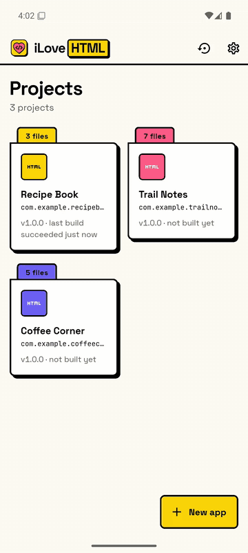
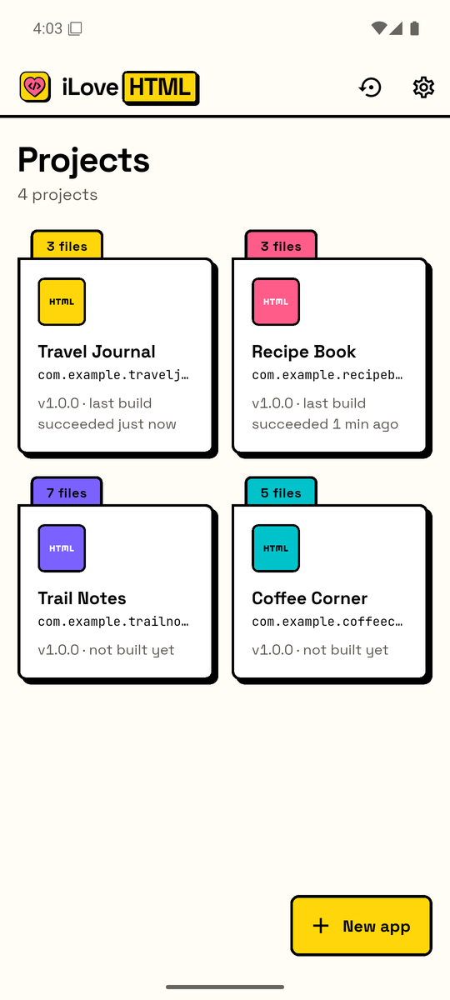
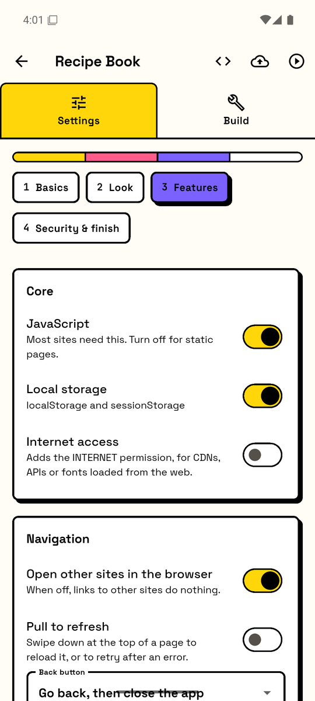
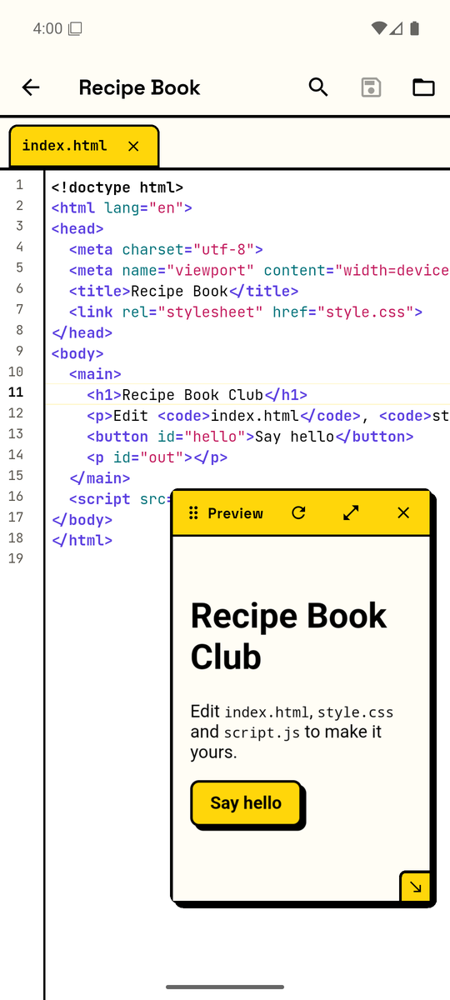
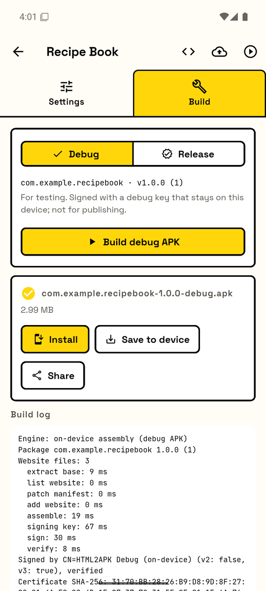
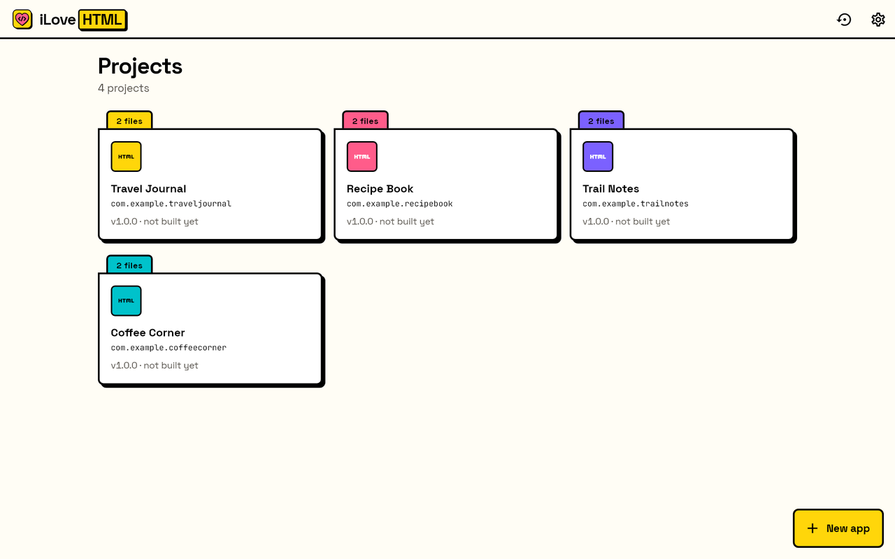
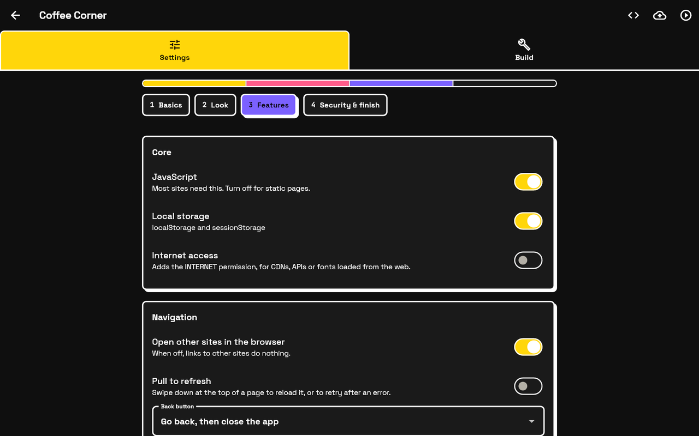

<p align="center">
  
</p>

<p align="center">
  <b>Turn HTML files, a website ZIP or a live https site into an Android app (APK or App Bundle) or a Windows app (.exe or .msix).</b><br>
  Built on your own phone or PC: no account, no upload, no cloud.
</p>

<p align="center">
  <a href="https://github.com/1elevenop/iLoveHTML/releases/latest"></a>
  <a href="LICENSE"></a>
  <a href="https://github.com/1elevenop/iLoveHTML/actions/workflows/ci.yml"></a>
  
  
</p>

<p align="center">
  
</p>

<p align="center">
  <b><a href="https://github.com/1elevenop/iLoveHTML/releases/latest">Download iLoveHTML 1.2.5</a></b><br>
  Android APK (Android 10+) and Windows ZIP (10/11, 64-bit), with SHA-256 checksums.
</p>

## What it does

| | |
|---|---|
| **📦 Import anything** — HTML files (with their CSS, JS and images), a website ZIP, or a live https URL. | **✍️ Write it here** — start a blank site and edit HTML, CSS and JS with highlighting, find & replace and a live preview. |
| **⚙️ Set it up in 4 steps** — Basics → Look → Features → Security & finish, with a progress bar. | **📱 Build on the phone** — APK and App Bundle, signed on the device. No Gradle, no PC. |
| **🖥️ Build on Windows** — APKs and App Bundles with Gradle, plus `.exe` and signed `.msix` apps. | **🔒 Safe by default** — strict WebView settings, permission allow-list, no tracking ([security](docs/security-audit-2026-11.md)). |

## Screenshots

| Projects | 4-step settings | Code editor + live preview | Build on the phone |
|---|---|---|---|
|  |  |  |  |

| Windows | Dark mode |
|---|---|
|  |  |

## Quick start

**On Android** (Android 10 or newer)

1. Download `iLoveHTML-<version>.apk` from the
   [latest release](https://github.com/1elevenop/iLoveHTML/releases/latest)
   and open it (allow installs from your browser if Android asks).
2. Tap **New app** and pick your HTML files, a website ZIP, a URL, or
   **New blank site** to write one from scratch.
3. Walk through the four setting steps, then **Build** → **Build debug APK** → **Install**.

**On Windows** (10 or 11, 64-bit)

1. Download `iLoveHTML-<version>-windows-x64.zip`, unzip it anywhere and
   run `iLoveHTML.exe` (Windows may say "Windows protected your PC" because
   it isn't code-signed yet: choose More info → Run anyway).
2. For Android builds, install [Android Studio](https://developer.android.com/studio)
   once (it brings the JDK and Android SDK). Windows .exe apps need nothing extra.
3. **New app** → pick your site → **Build**. After an APK build, **Install on
   phone** shows a QR code to install it on a phone on the same Wi-Fi.

**From the command line** (any OS with Dart; Gradle builds need the JDK and Android SDK):

```powershell
cd packages/html2apk_core
dart run bin/html2apk.dart --zip ../../samples/demo-site.zip --name "iLoveHTML Demo" --id com.html2apk.demo --icon ../../samples/demo-icon.png --out ../../out
```

**Supported versions:** iLoveHTML for Android and every app it builds need
Android 10 (API 29) or newer ([ADR 0010](docs/adr/0010-android-10-minimum.md)).

## What's new in 1.2.5

- **New look:** a bold, high-contrast design with thick outlines, hard shadows
  and colour blocks, a new logo and app icon, light and dark mode, and five
  accent colours (yellow, pink, purple, teal, green).
- **Project settings in 4 steps:** Basics → Look → Features → Security &
  finish, with a progress bar. Jump to any step; Save checks every step and
  takes you to the one that needs fixing; the last step lists your unsaved changes.
- **Code editor:** edit a project's HTML, CSS and JavaScript in the app, with
  syntax highlighting, tabs, find & replace and a live preview (a floating
  window on Android, your browser on Windows). **New blank site** starts you
  off with a page, a stylesheet and a script.
- **Security:** the "Install on phone" link only answers devices on your own
  network segment, rate-limits requests and stops after 20 downloads; CI now
  scans for leaked secrets and vulnerable dependencies
  ([audit](docs/security-audit-2026-11.md)).

Older release notes: [CHANGELOG.md](CHANGELOG.md).

## Features

- **Projects:** new apps from one or more HTML files (CSS/JS/images picked
  alongside are moved into the folders the pages link to), a website ZIP, a
  live https URL (checked first: redirects followed hop by hop, private and
  local addresses blocked, title used as the app name), or a blank starter site.
- **Code editor:** HTML, CSS, JavaScript, JSON, SVG and Markdown files with
  highlighting, line numbers, tabs, unsaved markers, Ctrl+S, find & replace,
  and new / rename / delete. Files stay inside the project's site folder, up to
  2 MB each; the start page can't be deleted by accident.
- **Preview:** back/forward/reload, viewport presets, JavaScript console,
  missing-file and blocked-link reports.
- **Builds on the phone** without Gradle
  ([ADR 0002](docs/adr/0002-android-on-device-build.md)): debug and release
  APKs and App Bundles, with Install, Share and Save to device.
- **Generated apps:** loading bar, offline page with "Try again", other sites
  opened in the browser, status/navigation bar colours, splash screen,
  pull-to-refresh, file uploads, light/dark/follow-phone theme, fullscreen,
  keep screen on, back-button choices, app shortcuts, app lock, notifications,
  share and downloads, image/PDF sharing
  ([ADR 0009](docs/adr/0009-file-sharing.md)), Android TV and tablets.
- **Smaller apps:** "Optimize files when building" shrinks CSS, JSON, PNG and
  large JPEG files in the build only; the size report shows what takes space.
- **Windows** ([ADR 0006](docs/adr/0006-windows-desktop-app.md)): the same
  app building with the local JDK, Android SDK and Gradle; release keys
  encrypted for your Windows account (DPAPI); `.exe` apps with WebView2
  ([ADR 0007](docs/adr/0007-windows-exe-apps.md)) and signed `.msix`
  installers ([ADR 0008](docs/adr/0008-windows-msix-installers.md)).
- **Release signing** ([ADR 0004](docs/adr/0004-release-signing.md)) and
  **App Bundles for Google Play** ([ADR 0005](docs/adr/0005-app-bundles.md)).
- **Install by QR code (Windows):** after a build, "Install on phone" serves
  the APK on your Wi-Fi for 10 minutes behind a secret link. Plain HTTP: use
  it on a network you trust.
- **Project backup:** one `.ilovehtml` file with settings, site files, icon and
  splash (no builds, no signing keys); "Restore backup" opens it as a new project.
- Not built yet: camera/location and other native features, push
  notifications, templates.

## Brand and media

Logo, icons, screenshots and colours are in [`media/`](media/) — see the
[brand guide](media/brand.md).

## Contributing

Issues and pull requests are welcome. Read the
[architecture notes](docs/adr/) first, run the tests listed under
[Tests](#tests), and keep the [security defaults](#security-defaults-of-generated-apps)
of generated apps intact. Security issues: please report privately (see
[security review](docs/security-review.md)).

---


# For developers

## Layout

| Path | What |
|---|---|
| `app/` | Flutter app for Android and Windows on top of `html2apk_core` |
| `windows_template/` | C++ WebView2 wrapper for Windows .exe apps (ADR 0007) |
| `android_template/` | Native Kotlin WebView wrapper (Gradle project) used for every generated app |
| `android_engine/` | Kotlin on-device build engine (binary manifest editor, APK assembler, Keystore signing), shared by `app/` and the prototype |
| `packages/html2apk_core/` | Shared Dart core: project model, importer, security, generator, build orchestration |
| `android_ondevice_prototype/` | Minimal Android test app for the on-device engine |
| `tools/build_ondevice_base.ps1` | Builds the base APK and `base_info.json` for the on-device engine |
| `samples/` | Demo site, icon and ZIP for the end-to-end test |
| `media/` | Logo, icons sources, screenshots, social preview and brand guide |
| `docs/adr/` | Architecture decisions |

## Requirements (Windows)

- Android SDK with accepted licenses (Android Studio installs both)
- JDK 17+ (Android Studio's bundled `jbr` is detected automatically)
- Flutter 3.47+ / Dart 3.13+ (for the Dart core; tested with Flutter 3.47.7 at `C:\src\flutter`)
- Internet on the first build only (Gradle, AGP, AndroidX go into `~/.gradle`)
- For the Windows app: Visual Studio 2022 (Build Tools is enough) with
  "Desktop development with C++", Windows **Developer Mode** on, and the
  repo on an NTFS drive.
  Flutter links plugins with symlinks, which need Developer Mode and
  which exFAT drives cannot hold.

## Run the Windows app

```bash
cd app
flutter run -d windows
```

Or `flutter build windows` and start
`app\build\windows\x64\runner\Release\iLoveHTML.exe`; the
`android_template` folder next to the exe must stay with it. Projects and
keys live in `%APPDATA%\com.html2apk\html2apk_app\workspace`.

## Releasing iLoveHTML

1. Set `version:` in `app/pubspec.yaml` (raise the number after `+` every time).
2. `flutter build apk --release` and `flutter build windows --release` in `app/`.
3. Copy the APK and a ZIP of `app\build\windows\x64\runner\Release` (plus a
   read-me) into `release/v<version>/` with `SHA256SUMS.txt`. `release/` is not
   committed.

Release APKs are signed with iLoveHTML's own key when `app/android/key.properties`
exists (`storeFile`, `storePassword`, `keyAlias`, `keyPassword`); without it the
release build fails. For a local test build signed with the debug key, set
`HTML2APK_ALLOW_DEBUG_SIGNING=true` first. The key and its `key.properties` live outside the
repo; every future update must be signed with the same key, so keep a backup.

## Run the Android app

```bash
powershell -File tools/build_ondevice_base.ps1
```

Then, with a phone connected over adb:

```bash
cd app
flutter run
```

The base APK must be rebuilt whenever `android_template/` changes.

Pinned build versions are in [ADR 0003](docs/adr/0003-toolchain-versions.md).

## Build an APK from a ZIP

```bash
cd packages/html2apk_core
dart pub get
dart run bin/html2apk.dart --zip ../../samples/demo-site.zip --name "iLoveHTML Demo" --id com.html2apk.demo --icon ../../samples/demo-icon.png --out ../../out
```

Projects go to `.workspace/projects/<id>/`, generated Gradle projects and
`build.log` to `.workspace/builds/<id>/`.

## On-device build prototype

```bash
powershell -File tools/build_ondevice_base.ps1
```

Then build `android_ondevice_prototype` with `gradlew.bat assembleDebug`,
install it, and start it with:

```bash
adb shell am start -n com.html2apk.ondevice/.PrototypeActivity --ez autorun true
```

The generated APK and `result.json` (timings, memory) are written to
`/sdcard/Android/data/com.html2apk.ondevice/files/`.

## Testing without a phone (emulator)

An Android 16 x86_64 emulator (`html2apk_test`, Pixel 7 profile) runs on
this PC with WHPX acceleration:

```bash
"%LOCALAPPDATA%\Android\Sdk\emulator\emulator.exe" -avd html2apk_test -no-window -no-audio -no-boot-anim
```

Drop `-no-window` to see it. The debug build of `app/` includes x86_64,
so `adb -s emulator-5554 install app\build\app\outputs\flutter-apk\app-debug.apk`
works. Physical-device checks are still done at the end of each milestone.
An Android 10 (`html2apk_api29`) emulator, the oldest supported version,
is set up too; see [docs/testing.md](docs/testing.md) for all test layers.

## Milestone 6: hardening and testing (2026-10-22)

Android 7.0 was supported then; since 2026-11-07 the minimum is Android 10
([ADR 0010](docs/adr/0010-android-10-minimum.md)).

| Check | Android 7.0 (API 24) | Android 10 (API 29) | Android 16 (API 36) |
|---|---|---|---|
| Windows end-to-end (`tools/e2e_windows.ps1`: debug, release, AAB, install, page JS ran) | pass | pass | pass |
| On-device end-to-end (`integration_test/build_flow_test.dart`) | pass | pass | pass |
| Preview cannot read `file://`/`content://` (`integration_test/preview_security_test.dart`) | pass | pass | pass |
| Generated app: bar colours, page, pull-to-refresh | pass | pass | pass |

Bugs found and fixed:

- **AAB build failed on Android 7.x** (`java.util.Base64` missing, used by
  apksig's v1 signer). Bundles are now signed by our own `JarSigner`
  ([ADR 0005](docs/adr/0005-app-bundles.md)).
- **Invisible navigation-bar buttons on Android 7.x** with a light
  navigation-bar colour (dark buttons need API 26). The generated app now
  uses black there; Android 8.0+ keeps your colour.
- Security fixes from the [security review](docs/security-review.md): ZIP
  size limits now count bytes actually written to disk (not the sizes the
  ZIP claims), the preview WebView has `file://`/`content://` access off,
  and only allow-listed permissions can be requested.

Large site (42.5 MB ZIP, 2,142 files including 40 × 1 MB incompressible
images):

| | Import | Build | APK | Peak memory |
|---|---|---|---|---|
| Windows (Gradle) | — | 51 s | 44 MB | — |
| Android 16 emulator (in-app engine) | ~6 s | ~3.2 s engine time | 44 MB, runs | 603 MB peak RSS vs 487 MB before (debug build of the app) |

## Signing tests (desktop JVM)

```bash
cd android_engine
gradlew.bat test
```

## Tests

```bash
cd packages/html2apk_core
dart test
```

Widget tests: `cd app && flutter test`. On-device and Windows end-to-end
tests: [docs/testing.md](docs/testing.md).

## Verify an APK

```bash
"%LOCALAPPDATA%\Android\Sdk\build-tools\36.0.0\apksigner.bat" verify --print-certs out\com.html2apk.demo-1.0.0-debug.apk
```

## Troubleshooting

- *No JDK found*: set `JAVA_HOME` or install Android Studio.
- *SDK licenses not accepted*: open Android Studio > SDK Manager once.
- *First build slow*: it is downloading Gradle 9.8.2 and AGP 9.4.1; later builds take ~20 s.
- *Build log*: `.workspace/builds/<project-id>/build.log` (passwords and tokens are redacted).

## Security defaults of generated apps

No file or content-provider access from the WebView, bundled content
served from `https://appassets.androidplatform.net` through
`WebViewAssetLoader`, mixed content blocked, cleartext traffic disabled,
`INTERNET` permission only for URL projects or when explicitly enabled,
off-site links handed to the browser, WebView debugging only in debug builds.
`USE_BIOMETRIC` only when app lock is on, `POST_NOTIFICATIONS` only when
notifications are on. Share, saving files and notifications answer only the
app's own site, plus the hosts a URL project lists under "Sites that can
also share, save files and notify"; other sites that open inside the app do
not get them. App data is excluded from backups and device transfers.
Windows apps follow the same Downloads, File uploads and Local storage
switches. To report a security problem see [SECURITY.md](SECURITY.md).

## License

iLoveHTML is released under the [MIT License](LICENSE).
Windows apps it builds link Microsoft's WebView2 loader, which has its own
BSD-style licence from Microsoft.

[Privacy Policy](docs/privacy.md) · [Code signing policy](docs/code-signing-policy.md) · [Security](SECURITY.md)
